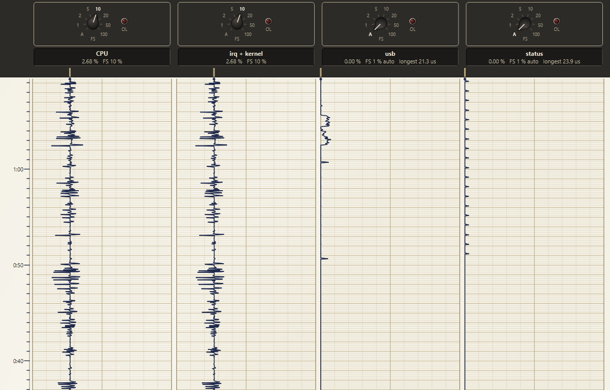

# Floret

**A run-to-completion kernel for small embedded systems.**

Wait for the event, and do only what's necessary to process it.

A daisy's flower head is not one flower: it is hundreds of tiny florets working together as one. A Floret application is built the same way: a handful of small tasks, each woken by events, each running to completion, sharing one stack and one CPU, with no context switches. Priority is simply the order of the task table. When nothing is happening, the CPU sleeps.

Floret is written in plain C11, has no dependencies, and is meant to be easy to read in an afternoon.

## Status

Floret runs on the [Electrosmith Daisy](https://electro-smith.com/) (STM32H750, Cortex-M7), through the `meadow` branch of a libDaisy fork: [a7v7/libDaisy](https://github.com/a7v7/libDaisy/tree/meadow). Its examples include:

- `Floret_Hello`: the smallest Floret app
- `Floret_Pod`: a Daisy Pod app with an adjustable load, to watch with Downlink
- `Floret_UsbAudio`: the Daisy as a USB audio interface (UAC2, stereo in and out), with the USB stack run by a Floret task

The kernel and queue have host unit tests. The API may still change before 1.0.

## What's in it

- **The kernel** ([floret.h](include/floret/floret.h)): a task table in priority order; three event classes per task (from interrupts, from the system, from the application); timers driven by a tick; and an idle that sleeps until the next interrupt.
- **A queue** ([floret_queue.h](include/floret/floret_queue.h)): single producer, single consumer, lock-free, with optional timestamps. Typically an interrupt puts and a task gets.
- **Flight Test** ([docs/flight_test.md](docs/flight_test.md)): a small telemetry block that the kernel keeps up to date, with the time spent in each handler, run counts, the longest dispatch and idle time. **Downlink** ([tools/downlink](tools/downlink)) reads it through the debug probe without stopping the target and draws it as a 1970s-style strip chart. An **uplink** word lets Downlink send commands back.



*Downlink watching `Floret_UsbAudio` on a Daisy Pod while it streams USB audio both ways: about 2.7 % CPU, almost all of it in interrupts (TinyUSB moves the audio in the USB interrupt). The `usb` task wakes only for the host's control requests, the burst near 1:05, and `status` ticks once a second when it prints a status line.*

The design, and the reasons behind it, are in [docs/design.md](docs/design.md).

## A Floret app

```c
static const floret_task_t tasks[] = {
//    name       init  isr      sys         usr
    { "usb",     NULL, usb_isr, NULL,       NULL       },   // row 0: highest priority
    { "status",  NULL, NULL,    status_sys, status_usr },
};

int main(void)
{
    board_init();
    floret_init(tasks, 2);
    floret_start();       // calls each init(), then sends FLORET_SYS_START
    floret_run();         // dispatch events; sleep when there's nothing to do
}
```

An interrupt handler calls `floret_signal(task, FLORET_ISR, bits)`; the kernel then calls that task's `isr` handler with the bits. A periodic interrupt calls `floret_tick()` to drive the timers. On a Daisy that's the audio callback, so Floret's timers follow the codec's clock.

## Porting

A platform supplies five functions ([floret_port.h](include/floret/floret_port.h)): a free-running clock (`floret_port_now`, `floret_port_now_hz`), a short critical section (`floret_port_lock`, `floret_port_unlock`), and `floret_port_sleep`. The Daisy port is about 50 lines.

## Building

Floret is a CMake library: add it with `add_subdirectory()` and link `floret`. To build and run the unit tests on your computer:

```bash
cmake -S . -B build -DFLORET_BUILD_TESTS=ON
cmake --build build
ctest --test-dir build
```

## License

MIT, see [LICENSE](LICENSE).
